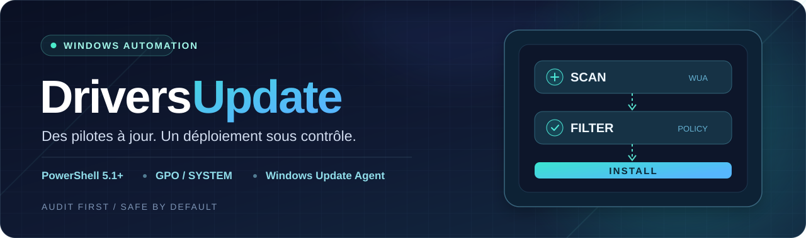

 

**L'automatisation des pilotes Windows pensée pour les parcs administrés.**  
Sans module externe · Sans interface utilisateur · Sans redémarrage forcé

[**Démarrer**](#démarrage-rapide) · [**Déployer via GPO**](#déploiement-par-gpo) · [**Configurer**](#configuration-des-filtres) · [**Superviser**](#journaux-et-supervision)

---

## Pourquoi DriversUpdate ?

Installer des pilotes sur un poste est simple. **Le faire proprement sur des dizaines ou des centaines de machines, sans perturber la politique Windows Update, l'est beaucoup moins.**

DriversUpdate utilise l'API native **Windows Update Agent (WUA)** pour rechercher, sélectionner et installer silencieusement les pilotes proposés à chaque machine. Il est particulièrement adapté aux déploiements **GPO + tâche planifiée + compte SYSTEM**, sans dépendance à un module PowerShell tiers.

| | |
| :--- | :--- |
| 🛡️ **Priorité aux politiques** Utilise la source Windows Update/WSUS pilotée par la configuration du poste. Ne modifie pas les stratégies machine. | 🔎 **Audit avant installation** Explore les pilotes disponibles avec <code>-ScanOnly</code> ou <code>-DryRun</code>, sans téléchargement ni installation. |
| 🎛️ **Filtres conservateurs** BIOS, firmware, réseau et stockage exclus par défaut. Règles personnalisables via JSON. | 🧰 **Pensé pour l'exploitation** Exécution SYSTEM, verrou anti-concurrence, journaux rotatifs, état JSON et codes retour exploitables. |

> [!IMPORTANT]
> **DriversUpdate n'installe pas tous les pilotes à tout prix.** Si une GPO exclut les pilotes de Windows Update, le script s'arrête sans contourner cette décision. Une source WSUS dépourvue de pilotes n'est pas remplacée automatiquement par une source Internet.

## Démarrage rapide

**Prérequis :** Windows 10/11, Windows PowerShell **5.1** (recommandé), droits administrateur et source de mises à jour accessible conformément aux stratégies du poste.

Récupérez le dépôt puis lancez **d'abord un audit** depuis une console PowerShell élevée :

~~~powershell
git clone https://github.com/neosoda/DriversUpdate.git
cd DriversUpdate

powershell.exe -NoProfile -File .\force_update_drivers_gpo_hardened.ps1 -ScanOnly
~~~

Pas de Git ? Téléchargez le [script principal](force_update_drivers_gpo_hardened.ps1) et placez-le dans un dossier local.

### Trois modes, un seul script

| Mode | Commande | Effet |
| :--- | :--- | :--- |
| **🔍 Scan** | <code>-ScanOnly</code> | Recherche et filtre les pilotes ; aucune installation. |
| **🧪 Simulation** | <code>-DryRun</code> | Même sélection que Scan, enregistrée comme simulation ; aucun téléchargement. |
| **⚡ Installation** | *Sans option de mode* | Télécharge et installe les pilotes éligibles. |

~~~powershell
# 1. Analyser, sans installer
powershell.exe -NoProfile -File .\force_update_drivers_gpo_hardened.ps1 -ScanOnly

# 2. Simuler les candidats à l'installation
powershell.exe -NoProfile -File .\force_update_drivers_gpo_hardened.ps1 -DryRun

# 3. Installer après validation sur un poste pilote
powershell.exe -NoProfile -File .\force_update_drivers_gpo_hardened.ps1

# 4. Relancer sans attendre l'intervalle minimal de 24 heures
powershell.exe -NoProfile -File .\force_update_drivers_gpo_hardened.ps1 -Force
~~~

> [!NOTE]
> Les modes Scan et Simulation utilisent aujourd'hui **la même logique de sélection**. Ils peuvent démarrer les services Windows Update nécessaires et écrivent des journaux/états locaux, mais **n'acceptent pas les EULA, ne téléchargent pas et n'installent pas** de pilotes. L'option <code>-Force</code> ignore uniquement l'intervalle de scan : elle ne neutralise ni les GPO ni les filtres de sécurité.

## Comment ça fonctionne ?

~~~mermaid
flowchart LR
    A["🖥️ Tâche SYSTEM"] --> B["🔎 Recherche WUA"]
    B --> C{"🛡️ Stratégies et filtres"}
    C -->|"Bloqué"| D["📝 Journaliser"]
    C -->|"Autorisé"| E{"Mode audit ?"}
    E -->|"Oui"| D
    E -->|"Non"| F["⬇️ Télécharger et installer"]
    F --> D

    classDef blue fill:#172D47,color:#E7F5FF,stroke:#4B98C9,stroke-width:1px;
    classDef aqua fill:#0E4748,color:#E8FFFA,stroke:#35C6B9,stroke-width:1px;
    classDef gray fill:#243047,color:#EAF0FC,stroke:#8291AA,stroke-width:1px;
    class A,B blue;
    class C,E aqua;
    class D,F gray;
~~~

La recherche cible les mises à jour de type **Driver**, non installées et non masquées. Les candidats nécessitant une interaction sont ignorés ; les autres passent les filtres avant installation.

## Configuration des filtres

Aucun fichier de configuration n'est obligatoire : des exclusions prudentes sont déjà intégrées.

Pour les personnaliser, copiez [config.example.json](config.example.json) vers :

<code>C:\ProgramData\DriversUpdate\config.json</code>

~~~json
{
  "ExcludedDriverClasses": [
    "Firmware",
    "Net",
    "SCSIAdapter",
    "HDC",
    "DiskDrive"
  ],
  "ExcludedTitleContains": [
    "BIOS",
    "Firmware"
  ],
  "IncludedTitleContains": []
}
~~~

| Paramètre | Rôle |
| :--- | :--- |
| <code>ExcludedDriverClasses</code> | Bloque les classes de pilotes indiquées, par exemple réseau et stockage. |
| <code>ExcludedTitleContains</code> | Bloque les titres contenant l'une des chaînes indiquées. |
| <code>IncludedTitleContains</code> | Si la liste n'est pas vide, **n'autorise que** les titres contenant au moins une chaîne. |

Les titres sont comparés **sans tenir compte de la casse**, par recherche de sous-chaîne (pas de regex). Une liste d'exclusion vide supprime la protection correspondante : à éviter sans validation préalable.

> [!TIP]
> Sur un parc hétérogène, commencez avec les exclusions par défaut. Validez ensuite tout élargissement par modèle de machine et sur un groupe pilote.

<strong>Afficher les paramètres du script</strong>

 

| Paramètre | Valeur / comportement |
| :--- | :--- |
| <code>-ScanOnly</code> | Audit sans téléchargement ni installation. |
| <code>-DryRun</code> | Simulation sans téléchargement ni installation. |
| <code>-Force</code> | Ignore la temporisation entre deux déploiements réussis. |
| <code>-MinimumScanIntervalHours</code> | 24 heures par défaut. |
| <code>-ConfigPath</code> | Chemin vers le JSON de configuration. |
| <code>-LogRoot</code> | Dossier des journaux. |
| <code>-StateRoot</code> | Dossier de l'état JSON. |
| <code>-AcceptEula</code> | <code>$true</code> par défaut, pour les pilotes installés. |
| <code>-TemporaryMicrosoftUpdateService</code> | **Déprécié** : accepté, mais ignoré en V2. |

## Déploiement par GPO

**Architecture recommandée :** une copie locale du script, puis une tâche planifiée GPO exécutée sous <code>NT AUTHORITY\SYSTEM</code>. Évitez une exécution synchrone au démarrage, qui peut ralentir l'ouverture de session ou se lancer avant la disponibilité des services.

### 1 · Distribuer le script

Dans **Configuration ordinateur → Préférences → Paramètres Windows → Fichiers**, copiez le script principal depuis SYSVOL vers :

<code>C:\ProgramData\DriversUpdate\force_update_drivers_gpo_hardened.ps1</code>

Distribuez aussi <code>config.json</code> si vous personnalisez les filtres.

### 2 · Créer la tâche planifiée

Dans **Configuration ordinateur → Préférences → Paramètres du Panneau de configuration → Tâches planifiées** :

| Champ | Valeur conseillée |
| :--- | :--- |
| Compte | <code>NT AUTHORITY\SYSTEM</code> |
| Privilèges | Exécuter avec les autorisations maximales |
| Déclencheur | Au démarrage, **différé de 15 à 60 min** |
| Récurrence facultative | Hebdomadaire, avec délai aléatoire |
| Programme | <code>%SystemRoot%\System32\WindowsPowerShell\v1.0\powershell.exe</code> |
| Arguments | <code>-NoProfile -ExecutionPolicy Bypass -File "C:\ProgramData\DriversUpdate\force_update_drivers_gpo_hardened.ps1"</code> |

### 3 · Valider avant généralisation

1. Liez d'abord la GPO à une **OU pilote** (différents constructeurs et modèles).
2. Exécutez **ScanOnly** puis contrôlez les pilotes exclus et la source de mises à jour utilisée.
3. Lancez une installation seulement sur les postes pilotes validés.
4. Vérifiez les journaux, codes retour, besoins de redémarrage et comportements après reboot.
5. Étendez progressivement le ciblage GPO.

> [!WARNING]
> **Aucun redémarrage n'est lancé par DriversUpdate.** Si Windows indique qu'un redémarrage est nécessaire, le script renvoie le code <code>3010</code>. Il appartient à votre outil de déploiement d'organiser ce redémarrage.

## Journaux et supervision

Les résultats sont enregistrés localement, pour être récupérés par un outil d'inventaire ou de supervision.

~~~text
C:\ProgramData\DriversUpdate\
├── force_update_drivers_gpo_hardened.ps1   # Copie locale si déployée
├── config.json                              # Facultatif
├── logs\
│   ├── deploy.log                           # Journal courant
│   └── deploy.log.1 / .2 / .3               # Archives
└── state\
    └── state.json                           # Dernier état connu
~~~

**Journal :** rotation dès 5 Mo, avec trois archives.  
**État JSON :** mode, source utilisée, pilotes détectés/installés, résultats détaillés, éventuel redémarrage et horodatages distincts (tentative, scan, scan réussi, déploiement réussi).

~~~powershell
# Afficher les 50 dernières lignes
Get-Content "$env:ProgramData\DriversUpdate\logs\deploy.log" -Tail 50

# Lire le dernier état, exploitable par GLPI, Zabbix ou un script d'inventaire
Get-Content "$env:ProgramData\DriversUpdate\state\state.json" -Raw |
    ConvertFrom-Json | Select-Object LastOutcome, LastExitCode, UpdatesFound, UpdatesInstalled, RebootRequired
~~~

L'intégration GLPI/Zabbix consiste à **collecter ce fichier JSON ou les codes retour** : le dépôt ne contient pas de connecteur réseau ou de tableau de bord central.

<strong>Afficher les codes de retour</strong>

 

| Code | Signification |
| ---: | :--- |
| **0** | Succès, aucun pilote ou exécution ignorée volontairement (voir <code>LastOutcome</code>). |
| **3010** | Installation réussie, redémarrage requis. |
| 100 | Version PowerShell non supportée. |
| 101 | Privilèges administrateur manquants. |
| 102 | Erreur de relance en PowerShell 64 bits. |
| 103 | Prérequis ou configuration invalide. |
| 110 | Échec de recherche Windows Update. |
| 120 | Échec de téléchargement. |
| 130 | Échec d'installation. |
| 140 | Résultat partiellement réussi. |
| 150 | Une exécution est déjà en cours. |
| 160 | Politiques Windows Update contradictoires. |
| 199 | Erreur inattendue. |

## Compatibilité & vérification

| Élément | Statut |
| :--- | :--- |
| Windows 10 / Windows 11 | ✅ Cibles prévues |
| Windows PowerShell 5.1 | ✅ Syntaxe et logique testées en CI |
| Tâche planifiée GPO / SYSTEM | ✅ Mode de déploiement conçu pour cet usage |
| WUA / WSUS / stratégies de source | ✅ Pris en compte dans le script |
| Installation réelle sur un parc | ⚠️ **À valider sur vos postes pilotes** |
| Modules PowerShell supplémentaires | ✅ Aucun requis à l'exécution |

Le workflow [PowerShell CI](.github/workflows/powershell-ci.yml) vérifie la **syntaxe**, des **scénarios de logique isolée** et les erreurs **PSScriptAnalyzer**, sous Windows PowerShell 5.1. Il ne simule **ni l'API COM Windows Update réelle ni l'installation physique des pilotes**.

~~~powershell
powershell.exe -NoProfile -File .\tests\validate.ps1
~~~

<strong>Versions historiques et migration</strong>

 

| Fichier | Statut |
| :--- | :--- |
| [force_update_drivers_gpo_hardened.ps1](force_update_drivers_gpo_hardened.ps1) | **V2 recommandée** |
| [force_update_driversV2_pourGPO.ps1](force_update_driversV2_pourGPO.ps1) | Ancienne version — dépréciée |
| [force_update_driversV2bis.ps1](force_update_driversV2bis.ps1) | Ancienne version interactive — dépréciée |

Le nom du script principal est inchangé pour faciliter la migration depuis les GPO existantes. Les scripts historiques restent accessibles, mais les nouveaux déploiements doivent cibler la V2.

---

**Conçu pour les admins qui veulent automatiser sans perdre le contrôle.**

Développé et maintenu par [**neosoda**](https://github.com/neosoda) · Distribué sous [licence MIT](LICENSE)

[⭐ Mettre une étoile](https://github.com/neosoda/DriversUpdate/stargazers) · [🐛 Signaler un problème](https://github.com/neosoda/DriversUpdate/issues) · [🔧 Proposer une amélioration](https://github.com/neosoda/DriversUpdate/pulls)

