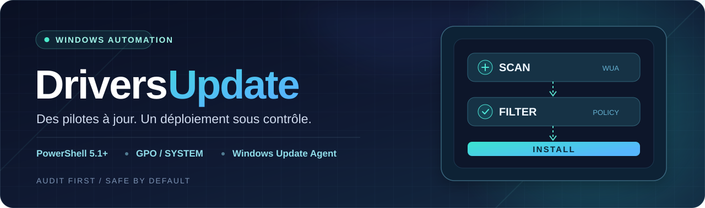

# DriversUpdate

**Mettre à jour les pilotes Windows, manuellement ou automatiquement, sans perdre le contrôle.**

**2 scripts autonomes · Configuration intégrée · Proxy facultatif · GPO / SYSTEM · Aucun redémarrage automatique**

[Choisir un script](#-deux-scripts-deux-usages) · [Configuration du proxy](#-configuration-du-proxy) · [Déploiement GPO](#-déploiement-gpo--system) · [Mode manuel](#-exécution-manuelle) · [Diagnostic](#-diagnostic-et-journaux)

---

## 🧭 Deux scripts, deux usages

| Fichier | Usage | Interface | Proxy par défaut |
| --- | --- | --- | --- |
| **[force_update_drivers_gpo_hardened.ps1](force_update_drivers_gpo_hardened.ps1)** | Déploiement par GPO / tâche planifiée sous SYSTEM, sans session ouverte | Silencieuse | Activé, à configurer |
| **[DriversUpdate-Manual.ps1](DriversUpdate-Manual.ps1)** | Maintenance ponctuelle par un administrateur | Menu en français, sélection et confirmation | Désactivé |

**Chaque fichier fonctionne seul.** Le moteur Windows Update est intégré aux deux PS1 : aucun second script, module PowerShell tiers, fichier JSON ou fichier d'identifiants n'est nécessaire pour les exécuter.

Les journaux et fichiers d'état sont créés automatiquement pendant l'exécution. Ils ne font pas partie des fichiers à distribuer.

### Fonctionnement

- Recherche les mises à jour de **pilotes** proposées par la source Windows Update / WSUS autorisée par les stratégies du poste.
- Applique les exclusions de sécurité, puis télécharge et installe uniquement les pilotes éligibles.
- Exclut par défaut les classes **Firmware, Net, SCSIAdapter, HDC, DiskDrive**, ainsi que les titres contenant **BIOS** ou **Firmware**.
- Écarte les installations demandant une interaction utilisateur ou dont le caractère silencieux ne peut pas être confirmé.
- Conserve un bilan JSON exploitable en supervision (par exemple GLPI ou Zabbix) et n'effectue **aucun redémarrage automatique**.

> [!IMPORTANT]
> L'outil ne contourne pas les stratégies Windows Update / WSUS. Une GPO qui exclut les pilotes ou interdit certaines sources reste prioritaire. Testez les pilotes sur un périmètre pilote avant tout déploiement large.

## 🌐 Configuration du proxy

Les paramètres sont **directement dans chaque PS1**, au début du fichier.

~~~powershell
$ProxyEnabled = $true
$ProxyHost = '172.17.0.1'
$ProxyPort = 3128
$ProxyBypassList = '<local>'
$ProxyUser = 'UTILISATEUR'
$ProxyPassword = 'MOT_DE_PASSE'
$ProxyAuthScheme = 'Basic'
~~~

L'adresse et le port ci-dessus sont des **valeurs d'exemple**, à adapter à votre réseau. Le nom d'utilisateur et le mot de passe sont des espaces réservés : tant qu'ils conservent ces valeurs, le script refuse d'utiliser un proxy activé.

| Paramètre | Description |
| --- | --- |
| **ProxyEnabled** | true : proxy WinHTTP temporaire ; false : conserve le proxy machine existant |
| **ProxyHost / ProxyPort** | Hôte ou IPv4 et port du proxy, séparément, sans préfixe HTTP |
| **ProxyBypassList** | Exceptions WinHTTP (par exemple les adresses locales) |
| **ProxyUser / ProxyPassword** | Identifiants du proxy ; mettre **les deux à chaîne vide** si aucune authentification n'est nécessaire |
| **ProxyAuthScheme** | Basic, NTLM, Negotiate ou Digest, selon le proxy |

Le script GPO est fourni avec **ProxyEnabled = true** ; le script manuel avec **ProxyEnabled = false**.

### Proxy sous SYSTEM, sans utilisateur connecté

Quand le proxy est activé, le moteur :

1. Sauvegarde la configuration WinHTTP de la machine.
2. Applique temporairement le proxy machine et, lorsque nécessaire, transmet les identifiants.
3. Tente également de définir le proxy de la session Windows Update Agent lorsque l'interface COM le permet.
4. Tente de **restaurer WinHTTP à la fin**, y compris en cas d'erreur. Après une interruption brutale, il recherche ses sauvegardes au lancement suivant.

Cette méthode ne dépend pas de la configuration Internet du profil utilisateur. Elle doit toutefois être **validée sur un poste pilote** : l'authentification du proxy, Windows Update et les téléchargements BITS peuvent dépendre du contexte réseau et de la configuration Windows.

> [!CAUTION]
> **Un mot de passe dans un PS1 reste un secret en clair, même si le script l'utilise ensuite comme SecureString.** Ne publiez jamais la copie contenant vos identifiants sur GitHub, ni dans un SYSVOL ou un partage lisible par les utilisateurs du domaine. Protégez la copie locale et sa source de distribution avec des ACL adaptées. À l'échelle d'un parc, un proxy acceptant les machines ou une exception contrôlée pour Windows Update est préférable.

## 🖥️ Déploiement GPO / SYSTEM

**Prérequis :** Windows 10 ou 11, Windows PowerShell 5.1, droits d'administration et accès à la source de mises à jour autorisée.

1. Récupérez uniquement **[force_update_drivers_gpo_hardened.ps1](force_update_drivers_gpo_hardened.ps1)**.
2. Renseignez les paramètres de proxy dans la **copie destinée au déploiement**, si nécessaire.
3. Placez cette copie sur chaque poste dans un emplacement local réservé aux administrateurs, par exemple :

~~~text
C:\ProgramData\DriversUpdate\force_update_drivers_gpo_hardened.ps1
~~~

4. Créez une tâche planifiée via les préférences de **Configuration ordinateur** d'une GPO, exécutée sous **NT AUTHORITY\SYSTEM** avec les privilèges les plus élevés. Un déclenchement différé après le démarrage évite de lancer la recherche avant l'établissement du réseau.

**Programme :**

~~~text
%SystemRoot%\System32\WindowsPowerShell\v1.0\powershell.exe
~~~

**Arguments :**

~~~text
-NoProfile -ExecutionPolicy Bypass -File "C:\ProgramData\DriversUpdate\force_update_drivers_gpo_hardened.ps1"
~~~

Pour un premier test **sans téléchargement ni installation**, lancez sous le même contexte d'exécution :

~~~powershell
powershell.exe -NoProfile -ExecutionPolicy Bypass -File .\force_update_drivers_gpo_hardened.ps1 -ScanOnly -Force
~~~

Le moteur limite par défaut les déploiements automatiques répétés à **un succès toutes les 24 heures** ; le paramètre **-Force** ignore seulement ce délai, et non les politiques Windows Update. Un mutex empêche deux exécutions simultanées du même moteur.

### Paramètres utiles du moteur GPO

| Paramètre | Effet |
| --- | --- |
| **-ScanOnly** | Recherche et filtrage sans téléchargement ni installation |
| **-DryRun** | Simulation sans installation |
| **-Force** | Ignore l'intervalle entre deux déploiements réussis |
| **-MinimumScanIntervalHours** | Intervalle minimal, 24 heures par défaut |
| **-LogRoot / -StateRoot** | Emplacements personnalisés des journaux et de l'état |
| **-AcceptEula** | Acceptation des licences des pilotes éligibles (true par défaut) |

## 🛠️ Exécution manuelle

Téléchargez uniquement **[DriversUpdate-Manual.ps1](DriversUpdate-Manual.ps1)**. Pour le lancer simplement :

1. **Clic droit sur le PS1 → Exécuter avec PowerShell** (sur Windows 11, éventuellement **Afficher plus d'options**).
2. Acceptez la demande **UAC** de Windows.
3. Le menu s'ouvre automatiquement **en administrateur**.

Vous pouvez aussi le lancer depuis une console PowerShell standard, sans l'ouvrir préalablement en administrateur :

~~~powershell
powershell.exe -NoProfile -ExecutionPolicy Bypass -File .\DriversUpdate-Manual.ps1
~~~

Le script ouvre maintenant une **console dédiée et élevée** si nécessaire, y compris lorsque le lancement depuis l'Explorateur redirige l'entrée PowerShell. La fenêtre reste ouverte si une erreur apparaît au démarrage, afin que vous puissiez la lire ; elle se ferme normalement via **0 — Quitter**. Si l'UAC est refusée, rien n'est installé (code 101).

Si « Exécuter avec PowerShell » n'ouvre toujours aucune fenêtre, lancez la commande ci-dessus dans une console déjà ouverte : **le message d'erreur restera visible** (par exemple une stratégie d'exécution GPO bloquante). **Aucun lanceur .cmd ni troisième fichier n'est nécessaire.**

~~~text
========================================================
   DRIVERSUPDATE | GESTION DES PILOTES WINDOWS
========================================================

 [1] Rechercher les pilotes disponibles
 [2] Cocher les pilotes à installer
 [3] Afficher le dernier bilan
 [4] Consulter le journal technique
 [0] Quitter
~~~

### Choisir et installer en un clic

Dans le menu, choisissez **2**. Une fenêtre Windows native s'ouvre après la recherche des pilotes :

- **Cochez** les pilotes souhaités à la souris (ou au clavier avec la barre d'espace).
- Utilisez **Tout cocher** ou **Tout décocher** si besoin.
- Cliquez sur **Installer la sélection**. Le téléchargement et l'installation démarrent immédiatement.
- **Annuler** ou fermer la fenêtre n'installe rien.

Il n'y a **plus de commande T/V, ni de confirmation RISQUES ou INSTALLER** à saisir. Aucun fichier externe n'est nécessaire : l'interface Windows Forms fait partie du script PowerShell.

Si Windows Forms ne peut pas s'ouvrir (environnement sans interface graphique), le script bascule sur une sélection console simplifiée : saisir simplement **1,3** pour installer les pilotes 1 et 3, **T** pour tous, ou **0** pour annuler, sans validation supplémentaire.

Les pilotes avec `CanRequestUserInput = true` restent proposés en manuel, mais certaines installations peuvent encore être refusées par Windows Update selon le contexte. Les filtres du script **GPO** ne sont pas modifiés. Le script ne provoque pas de redémarrage automatique.

## 📋 Diagnostic et journaux

L'outil écrit ses fichiers dans **C:\ProgramData\DriversUpdate** :

~~~text
C:\ProgramData\DriversUpdate\
├── logs\
│   └── deploy.log            # Journal courant (rotation à 5 Mo)
└── state\
    ├── state.json            # Dernier bilan
    └── proxy\                # Sauvegardes WinHTTP temporaires, si nécessaire
~~~

**Vérifier le dernier traitement :**

~~~powershell
Get-Content "$env:ProgramData\DriversUpdate\logs\deploy.log" -Tail 50

Get-Content "$env:ProgramData\DriversUpdate\state\state.json" -Raw |
    ConvertFrom-Json |
    Select-Object LastOutcome, LastExitCode, UpdatesFound, UpdatesInstalled, RebootRequired

netsh winhttp show proxy
~~~

**Codes retour principaux :**

| Code | Signification |
| ---: | --- |
| 0 | Réussite, recherche seule, annulation ou opération ignorée ; vérifier **LastOutcome** |
| 3010 | Installation réussie, redémarrage nécessaire (**non automatique**) |
| 100 / 101 / 102 / 103 | Prérequis : PowerShell, privilèges, architecture ou configuration |
| 110 / 120 / 130 | Échec de recherche / téléchargement / installation |
| 140 | Résultat partiel |
| 150 | Une autre exécution est déjà active |
| 160 | Stratégies Windows Update contradictoires |
| 199 | Erreur inattendue |

### En cas de problème

- **Aucun pilote trouvé :** vérifier les stratégies WSUS, les exclusions et la source de mises à jour autorisée.
- **Échec de recherche ou téléchargement :** examiner le journal, le proxy WinHTTP et les éventuelles erreurs d'authentification HTTP 407.
- **Échec de restauration du proxy :** ne pas supprimer les sauvegardes présentes dans le dossier state/proxy avant diagnostic ; le code 103 peut signaler cette situation.
- **Pas d'utilisateur connecté :** utiliser le script GPO sous SYSTEM et non le script manuel.

## 🧪 Tests et limites

Depuis Windows PowerShell 5.1, à la racine du dépôt :

~~~powershell
.\tests\validate.ps1
~~~

Ces tests vérifient notamment les points d'entrée, les filtres, la configuration intégrée et certaines fonctions internes. **Ils ne remplacent pas un test de recherche, téléchargement et installation réels sur Windows**, particulièrement pour un proxy authentifié sous SYSTEM.

---

Distribué sous [licence MIT](LICENSE).
